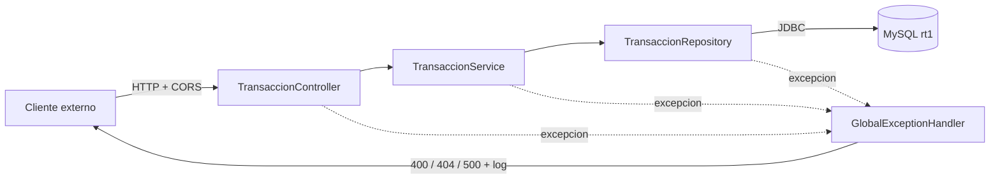

# agents.md — API de Transacciones (Spring Boot + JDBC + MySQL)

Guía del proyecto para agentes de IA y desarrolladores: arquitectura, convenciones, endpoints y cómo trabajar sobre el código.

## 1. Resumen

Microservicio REST que expone operaciones de **consulta paginada** y **eliminación** de transacciones financieras almacenadas en MySQL, usando **JDBC (`JdbcTemplate`)** sin JPA.

| Elemento | Valor |
|---|---|
| Framework | Spring Boot 4.2.0 (`spring-boot-starter-webmvc`, `spring-boot-starter-jdbc`) |
| Java | 21 |
| Base de datos | MySQL — `localhost:3306`, BD `rt1`, usuario `root`, contraseña `root` |
| Driver | `com.mysql:mysql-connector-j` |
| Pool | HikariCP (incluido en el starter JDBC) |
| Logs | Logback (`logback-spring.xml`) → carpeta `logs/` |
| Paquete base | `com.microserviviort.api` |
| Puerto | `8080` |

## 2. Estructura

```
api/
├── pom.xml
└── src/main/
    ├── java/com/microserviviort/api/
    │   ├── ApiApplication.java                 # Punto de entrada
    │   ├── config/
    │   │   └── CorsConfig.java                 # CORS global para /api/**
    │   ├── controller/
    │   │   └── TransaccionController.java      # @RestController /api/transacciones
    │   ├── service/
    │   │   └── TransaccionService.java         # Validaciones + reglas de negocio
    │   ├── repository/
    │   │   └── TransaccionRepository.java      # SQL con JdbcTemplate + RowMapper
    │   ├── model/
    │   │   └── transaccion.java                # POJO de la tabla
    │   ├── dto/
    │   │   ├── PageResponse.java               # Respuesta paginada
    │   │   └── ApiError.java                   # Respuesta de error estándar
    │   └── exception/
    │       ├── BadRequestException.java        # -> 400
    │       ├── ResourceNotFoundException.java  # -> 404
    │       ├── DataAccessLayerException.java   # -> 500
    │       └── GlobalExceptionHandler.java     # @RestControllerAdvice
    └── resources/
        ├── application.properties
        └── logback-spring.xml
```

### Flujo de una petición



## 3. Base de datos

Tabla esperada (nombre configurable con `app.tabla.transacciones`, por defecto `transactions`):

```sql
CREATE TABLE IF NOT EXISTS transacciones (
  id            INT AUTO_INCREMENT PRIMARY KEY,
  tipo          ENUM('ingreso','gasto') NOT NULL,
  monto         DECIMAL(15,2) NOT NULL,
  fecha         DATE NOT NULL,
  descripcion   TEXT,
  created_at    TIMESTAMP DEFAULT CURRENT_TIMESTAMP,
  metodo_pago   ENUM('efectivo','transferencia','tarjeta','cheque') NULL,
  categoria_id  INT NULL,
  referencia    VARCHAR(100) NULL UNIQUE,
  created_by    INT NULL,
  id_socio      INT NULL,
  estado        ENUM('pendiente','confirmada','anulada') DEFAULT 'confirmada'
);
```

> Si la tabla real tiene otro nombre, cambie `app.tabla.transacciones` en `application.properties` (solo se aceptan caracteres `[A-Za-z0-9_]`).

## 4. Endpoints

Base: `http://localhost:8080/api/transacciones`

| Método | Ruta | Descripción | Éxito |
|---|---|---|---|
| GET | `/api/transacciones?page=0&size=10` | Consulta paginada (orden `fecha DESC, id DESC`) | 200 |
| GET | `/api/transacciones/{id}` | Consulta una transacción | 200 |
| DELETE | `/api/transacciones/{id}` | Elimina una transacción | 200 |

**Parámetros de paginación**

- `page`: índice desde 0 (por defecto `0`, debe ser ≥ 0).
- `size`: tamaño de página (por defecto `app.paginacion.tamano-defecto=10`, entre 1 y `app.paginacion.tamano-maximo=100`).

**Ejemplo de respuesta paginada**

```json
{
  "content": [
    {
      "id": 15, "tipo": "ingreso", "monto": 250000.00, "fecha": "2026-11-20",
      "descripcion": "Aporte", "createdAt": "2026-11-20T10:15:00",
      "metodoPago": "transferencia", "categoriaId": 2, "referencia": "TRX-0015",
      "createdBy": 1, "idSocio": 7, "estado": "confirmada"
    }
  ],
  "page": 0, "size": 10, "totalElements": 42, "totalPages": 5,
  "first": true, "last": false
}
```

**Ejemplo eliminar**

```json
{ "status": 200, "message": "Transaccion 15 eliminada correctamente", "id": 15 }
```

**Pruebas rápidas**

```bash
curl "http://localhost:8080/api/transacciones?page=0&size=5"
curl "http://localhost:8080/api/transacciones/1"
curl -X DELETE "http://localhost:8080/api/transacciones/1"
curl "http://localhost:8080/api/transacciones?page=-1"     # 400
curl "http://localhost:8080/api/transacciones/abc"         # 400
```

## 5. Manejo de errores

Todas las respuestas de error usan `ApiError`:

```json
{
  "timestamp": "2026-11-23T15:55:00",
  "status": 400,
  "error": "Bad Request",
  "message": "El parametro 'size' debe estar entre 1 y 100",
  "path": "/api/transacciones"
}
```

| Código | Causa | Origen |
|---|---|---|
| 400 | `page`/`size` fuera de rango, id ≤ 0, tipo de parámetro inválido, parámetro faltante, body ilegible | `BadRequestException`, `MethodArgumentTypeMismatchException`, `MissingServletRequestParameterException`, `HttpMessageNotReadableException` |
| 404 | Transacción o ruta inexistente | `ResourceNotFoundException`, `NoResourceFoundException` |
| 405 | Método HTTP no soportado | `HttpRequestMethodNotSupportedException` |
| 500 | Fallo de BD (conexión, SQL) o error inesperado | `DataAccessLayerException`, `DataAccessException`, `Exception` |

Los errores 500 **nunca** exponen detalles internos al cliente; el detalle completo (stack trace) queda en el log.

### Estrategia try/catch

- **Repository**: cada operación JDBC está en `try/catch (DataAccessException)`; registra `log.error(...)` con el stack trace y relanza `DataAccessLayerException`.
- **Service**: valida entradas (`BadRequestException`) y existencia (`ResourceNotFoundException`), registra `info`/`warn`.
- **Controller**: `try/catch (RuntimeException)` registra el fallo del endpoint y relanza para que lo traduzca `GlobalExceptionHandler`.
- **GlobalExceptionHandler**: registra `warn` para 4xx y `error` (con stack trace) para 5xx, y construye la respuesta HTTP.

## 6. CORS

`CorsConfig` habilita CORS en `/api/**`:

- Orígenes: `app.cors.allowed-origins` (por defecto `*`; acepta lista separada por comas, p. ej. `http://localhost:4200,https://midominio.com`).
- Métodos: `GET, POST, PUT, DELETE, OPTIONS`.
- Headers: todos. `maxAge`: 3600 s.

## 7. Logs

Configurados en `logback-spring.xml`:

| Archivo | Contenido |
|---|---|
| `logs/api.log` | Todo el log de la aplicación (INFO+, DEBUG para `com.microserviviort.api` y SQL de `JdbcTemplate`) |
| `logs/api-error.log` | Solo WARN y ERROR |
| `logs/archived/*.log.gz` | Rotación diaria o al superar 10 MB (30 días app / 60 días errores) |

Patrón: `yyyy-MM-dd HH:mm:ss.SSS [hilo] NIVEL logger - mensaje`.

## 8. Ejecutar

Requisitos: JDK 21, MySQL en `localhost:3306` con la base `rt1`.

```bash
cd api
./mvnw spring-boot:run          # Linux/Mac
mvnw.cmd spring-boot:run        # Windows
# o empaquetar
./mvnw clean package && java -jar target/api-0.0.1-SNAPSHOT.jar
```

## 9. Convenciones para agentes

- Mantener la arquitectura en capas: **Controller → Service → Repository**. El controller no accede a `JdbcTemplate`.
- Usar **siempre** parámetros `?` en SQL (nunca concatenar valores del usuario).
- Toda operación JDBC nueva debe ir en `try/catch (DataAccessException)` con `log.error` y relanzar `DataAccessLayerException`.
- Validaciones de entrada → `BadRequestException` (400). Recurso inexistente → `ResourceNotFoundException` (404).
- Usar SLF4J (`LoggerFactory.getLogger(...)`); no usar `System.out.println`.
- Nuevas propiedades configurables con prefijo `app.` en `application.properties`.
- La clase de modelo se llama `transaccion` (minúscula) por compatibilidad con el proyecto original; no renombrar sin actualizar todas las referencias.
- No exponer stack traces ni mensajes de SQL en las respuestas HTTP.
